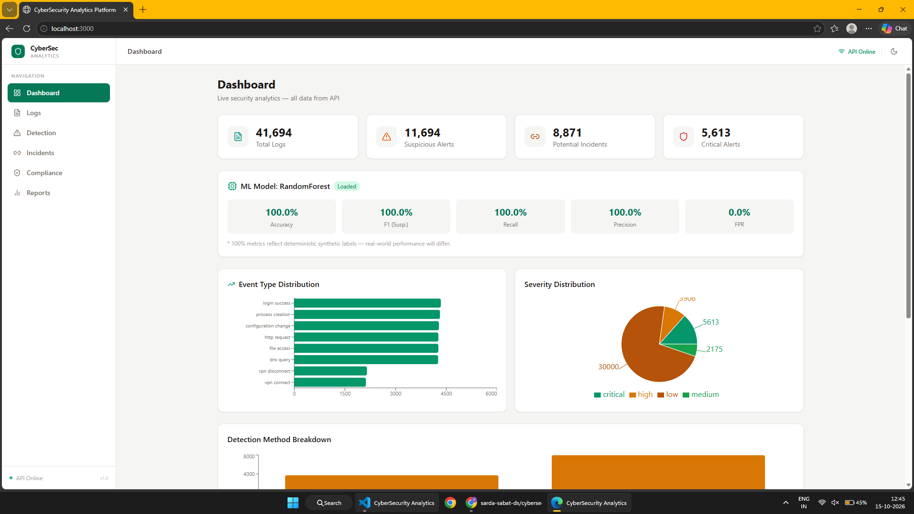
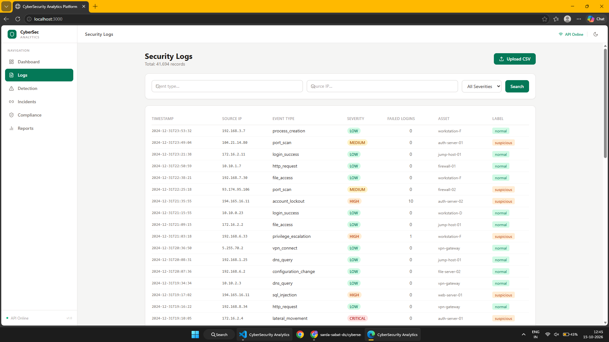
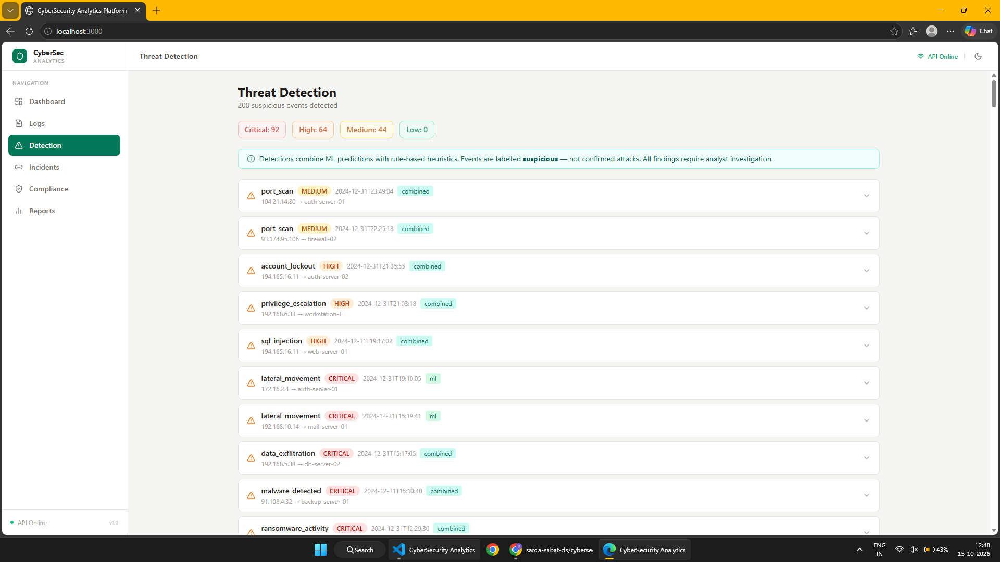

# Cybersecurity Analytics: AI/ML-Based Threat Detection and Alert Correlation

An end-to-end cybersecurity analytics platform developed as part of an **AI/ML Internship Technical Assessment**. The system combines machine learning, rule-based detection, alert correlation, and interactive security analytics to identify potentially suspicious activity and support security investigations.

The project uses **41,000+ synthetically generated records**, compares three supervised machine learning algorithms, and integrates the resulting workflow into a full-stack web application.

**Repository:** [sarda-sabat-ds/cybersecurity-analytics](https://github.com/sarda-sabat-ds/cybersecurity-analytics)

## Table of Contents

- [Project Overview](#project-overview)
- [Live Demo and Screenshots](#live-demo-and-screenshots)
- [Problem Statement](#problem-statement)
- [Key Features](#key-features)
- [System Architecture](#system-architecture)
- [Technology Stack](#technology-stack)
- [Dataset and Data Preparation](#dataset-and-data-preparation)
- [Machine Learning Pipeline](#machine-learning-pipeline)
- [Model Training and Selection](#model-training-and-selection)
- [Evaluation Metrics](#evaluation-metrics)
- [Detection and Alert Correlation](#detection-and-alert-correlation)
- [Backend Architecture](#backend-architecture)
- [Frontend Architecture](#frontend-architecture)
- [Database Design](#database-design)
- [Data Versioning with DVC](#data-versioning-with-dvc)
- [Project Structure](#project-structure)
- [Installation and Setup](#installation-and-setup)
- [Running the Application](#running-the-application)
- [API Documentation](#api-documentation)
- [Testing and Validation](#testing-and-validation)
- [Limitations and Future Improvements](#limitations-and-future-improvements)
- [Conclusion](#conclusion)

---

## Project Overview

Cybersecurity environments generate large volumes of event logs from user accounts, applications, servers, and network infrastructure. Reviewing these events manually can make it difficult to identify suspicious patterns, prioritize alerts, and understand relationships between multiple security events.

This project addresses that challenge by developing an integrated analytics platform that applies machine learning to cybersecurity records and presents the results through a web-based interface.

The system combines a supervised classification pipeline with rule-based detection and alert correlation. Its frontend provides a centralized interface for exploring logs, reviewing alerts, examining incidents, and accessing security analytics.

### Project objectives

- Process and analyze 41,000+ synthetically generated cybersecurity records.
- Train and compare Logistic Regression, Random Forest, and Decision Tree classifiers.
- Evaluate classification performance using multiple metrics.
- Select a suitable model using documented evaluation criteria.
- Integrate model inference into a FastAPI backend.
- Use MongoDB for application data persistence.
- Develop an interactive frontend using React and TypeScript.
- Track dataset versions and improve experiment reproducibility with DVC.
- Provide security analytics, alert correlation, and assessment reporting.

## Live Demo and Screenshots

The following gallery is organized into two columns, with a title and a short description for each screenshot.

Replace the example image paths below with the exact filenames present in `cyber-security-screenshots/`. GitHub renders these relative image paths directly in the repository README.

<table>
  <tr>
    <td width="50%" align="center">
      
      <strong>Security Analytics Dashboard</strong>
      <p align="left">Provides a consolidated view of security events, alert statistics, incident summaries, and activity trends.</p>
    </td>
    <td width="50%" align="center">
      
      <strong>Security Log Management</strong>
      <p align="left">Displays ingested event records for structured inspection and analysis.</p>
    </td>
  </tr>
  <tr>
    <td width="50%" align="center">
      
      <strong>Threat Detection and Alerts</strong>
      <p align="left">Presents potentially suspicious records identified by the machine learning and detection workflow.</p>
    </td>
    <td width="50%" align="center">
      
      <strong>Incident Correlation</strong>
      <p align="left">Groups related alerts to help analysts investigate potentially connected security events.</p>
    </td>
  </tr>
  <tr>
    <td width="50%" align="center">
      
      <strong>Security Analytics</strong>
      <p align="left">Visualizes security activity, event distributions, and detection trends.</p>
    </td>
    <td width="50%" align="center">
      
      <strong>Security Assessment Reports</strong>
      <p align="left">Presents assessment summaries and report-generation functionality.</p>
    </td>
  </tr>
</table>

**Note:** The screenshot filenames above are illustrative. Update the paths and descriptions to match the actual screenshots and features available in the application.

## Problem Statement

Security monitoring systems can produce a substantial number of events and alerts. Investigating every event independently consumes time and can make it difficult to recognize relationships between seemingly separate activities.

A useful cybersecurity analytics system should help answer three questions:

1. Which events appear suspicious?
2. Which alerts may be related to the same security incident?
3. How can the results be presented in a form that supports investigation and reporting?

### Proposed approach

The platform combines three complementary components:

**Machine learning classification:** Learns patterns from labelled cybersecurity records and predicts whether an event belongs to the normal or suspicious class.

**Rule-based detection:** Applies explicit conditions to identify configured security patterns that may require investigation.

**Alert correlation:** Groups related alerts using configured relationships, such as common source addresses, affected assets, time windows, or attack-sequence rules.

The results are exposed through a web application for analysis and reporting.

A model prediction or correlated alert is an indication for investigation, not proof that a cyberattack has occurred.

## Key Features

| Feature | Description |
|---|---|
| Synthetic dataset | Works with more than 41,000 generated records. |
| Supervised classification | Compares three machine learning algorithms. |
| Model evaluation | Uses accuracy, precision, recall, F1-score, and false-positive rate. |
| Data ingestion | Supports compatible event datasets and CSV workflows. |
| Threat detection | Combines model predictions with configured detection rules. |
| Alert correlation | Groups related alerts into potential incidents. |
| Security dashboard | Presents event summaries and analytics. |
| Compliance mapping | Associates findings with relevant security framework controls. |
| Assessment reports | Supports report generation where implemented. |
| REST API | Connects the frontend with backend functionality. |
| Persistent storage | Uses MongoDB for application data. |
| Data versioning | Uses DVC to track dataset versions and support reproducibility. |

## System Architecture

The application separates data preparation, model training, backend processing, database storage, and frontend presentation.

```text
                    DATA SOURCES
             Synthetic Records / CSV Files
                         |
                         v
                  DATA INGESTION
                         |
                         v
               DATA VALIDATION
                         |
                         v
                PREPROCESSING
        Cleaning / Encoding / Transformation
                         |
                         v
                 DATA SPLITTING
             Training / Validation / Test
                         |
                         v
                 MODEL TRAINING
                         |
          +--------------+--------------+
          |              |              |
          v              v              v
      Logistic        Random         Decision
     Regression       Forest          Tree
          |              |              |
          +--------------+--------------+
                         |
                         v
                 MODEL EVALUATION
        Accuracy / Precision / Recall / F1
                  / False-Positive Rate
                         |
                         v
                  MODEL SELECTION
                         |
                         v
                 SAVED MODEL ARTIFACT
                         |
                         v
                 FASTAPI BACKEND
                         |
             +-----------+-----------+
             |                       |
             v                       v
       ML Predictions          Detection Rules
             |                       |
             +-----------+-----------+
                         |
                         v
                  ALERT GENERATION
                         |
                         v
                  ALERT CORRELATION
                         |
                         v
                 INCIDENT ANALYSIS
                         |
                         v
                     MONGODB
                         |
                         v
                    REST APIs
                         |
                         v
               REACT + TYPESCRIPT
                         |
                         v
              DASHBOARD AND REPORTS

        DVC: Dataset and data-version tracking
        Git: Source-code version control
```

### End-to-end data flow

1. **Ingestion:** The system receives records from the synthetic dataset or a compatible CSV file.
2. **Validation:** Required columns, data types, and labels are checked.
3. **Preprocessing:** Records are transformed into a consistent numerical representation suitable for model training or inference.
4. **Training:** Candidate classifiers learn patterns from the training data.
5. **Evaluation:** Candidate models are evaluated on held-out data using consistent metrics.
6. **Selection:** A model is chosen according to the defined selection criteria.
7. **Inference:** The backend loads the selected model and evaluates new records.
8. **Detection:** Model predictions and configured security rules contribute to alert generation.
9. **Correlation:** Related alerts are grouped into potential incidents.
10. **Persistence:** Relevant application records are stored in MongoDB.
11. **Presentation:** FastAPI exposes data to the React frontend.
12. **Reporting:** Available reporting functionality converts assessment data into a human-readable output.

DVC supports the data lifecycle by tracking dataset versions and associated metadata. It does not replace Git or automatically guarantee model reproducibility without the corresponding code, configuration, dependencies, and model artifacts.

## Technology Stack

| Component | Technology | Role |
|---|---|---|
| Programming language | Python | ML pipeline, data processing, and backend logic |
| Data processing | Pandas, NumPy | Data manipulation and numerical computation |
| Machine learning | Scikit-learn | Classification, preprocessing, and evaluation |
| Model serialization | Joblib, if used | Persisting trained models |
| Frontend framework | React | Component-based user interface |
| Frontend language | TypeScript | Type-safe application development |
| Frontend build tooling | Vite | Development server and production builds |
| Backend framework | FastAPI | REST API and model-serving layer |
| Request validation | Pydantic | Validation of API inputs and outputs |
| ASGI server | Uvicorn | Running the FastAPI application |
| Database | MongoDB | Document-oriented application storage |
| Data versioning | DVC | Dataset tracking and reproducible data workflows |
| Source control | Git and GitHub | Code history and repository management |

Additional libraries should be documented only if they are present in the actual dependency files.

## Dataset and Data Preparation

### Dataset overview

The project uses more than 41,000 synthetically generated records to develop and evaluate the machine learning workflow.

Synthetic data is useful for controlled experimentation because it allows records and labels to be generated without directly exposing sensitive production logs.

| Property | Description |
|---|---|
| Dataset size | 41,000+ records |
| Source | Synthetically generated data |
| Learning paradigm | Supervised machine learning |
| Task | Binary classification of normal and suspicious activity |
| Input format | Dataset files and compatible CSV records |
| Primary purpose | Training, evaluation, and application testing |

The actual feature names, class distribution, generation rules, and label-generation method should be documented from the dataset-generation code.

### Data preprocessing

Before training, the pipeline prepares the raw dataset for consistent model input.

The preprocessing workflow should account for:

- Missing values and malformed records.
- Duplicate records where relevant.
- Categorical feature encoding.
- Numeric feature handling and scaling when required.
- Separation of input features from target labels.
- Consistent feature names and ordering.
- Reproducible train-test splitting.

Preprocessing parameters must be learned from the training set only. The same fitted transformations must then be applied to validation, test, and inference data.

This avoids information leakage and prevents the model from receiving differently transformed features during deployment.

### Handling class imbalance

Cybersecurity datasets may contain substantially more normal records than suspicious records.

The class distribution should therefore be examined before training. Stratified splitting helps preserve class proportions across subsets.

If resampling or class weighting is used, it should be applied within the training workflow and evaluated without modifying the held-out test distribution.

### Synthetic data limitations

Synthetic data may contain simpler patterns than real-world security logs. If the labels are generated directly from rules represented in the input features, a model may learn those rules and achieve unusually high scores.

Strong synthetic-data results demonstrate performance on the generated distribution; they do not establish production-level threat-detection capability.

## Machine Learning Pipeline

The machine learning pipeline converts structured event records into a trained classifier that can be used by the backend.

### 1. Data ingestion and validation

The input dataset is loaded into a structured representation. The pipeline validates the schema, checks the target column, and identifies invalid or missing values.

This stage prevents malformed records from silently entering model training.

**Output:** A validated dataset.

### 2. Feature engineering and preprocessing

The input features are separated from the target label.

Categorical variables are encoded into numerical representations. Numeric features are retained or scaled according to the requirements of the selected algorithms.

Any feature selection must be based on information available at prediction time. Features that directly reveal the target label or depend on future events should not be used.

**Output:** Model-ready features and labels.

### 3. Train-test splitting

The dataset is divided into training and test subsets. Stratification is appropriate when the target classes are imbalanced.

The training subset is used to fit models, while the test subset remains unseen until final evaluation.

If hyperparameter tuning is performed, it should use a validation set or cross-validation within the training subset.

**Output:** Separate training and evaluation datasets.

### 4. Candidate model training

Three supervised learning algorithms are compared.

#### Logistic Regression

Logistic Regression is a linear classification algorithm that estimates class probabilities from a weighted combination of input features.

It provides a useful baseline because it is relatively efficient, supports probability estimates, and can be easier to interpret than more complex models.

Its main limitation is that a basic model may not capture complicated nonlinear relationships unless appropriate feature transformations are introduced.

#### Random Forest

Random Forest is an ensemble algorithm that combines predictions from multiple decision trees trained with randomized samples and feature selection.

It can capture nonlinear relationships and interactions between features. It also provides feature-importance estimates that can help investigate which inputs influence the model.

Its disadvantages include higher computational cost and reduced direct interpretability compared with a single decision tree.

#### Decision Tree

A Decision Tree learns a hierarchy of feature-based conditions that lead to class predictions.

It can model nonlinear relationships and is relatively easy to inspect. It provides a useful comparison against both a linear baseline and an ensemble approach.

However, an unconstrained tree can overfit the training data. Parameters such as maximum depth and minimum samples per leaf can help control complexity.

### 5. Model evaluation

All candidate models should be evaluated using the same held-out test data and the same evaluation procedure.

The pipeline should record:

- Accuracy.
- Suspicious-class precision.
- Suspicious-class recall.
- Suspicious-class F1-score.
- False-positive rate.
- Confusion matrix.
- Per-class classification report.

This provides a more complete assessment than relying on a single metric.

### 6. Model selection

The final model should be selected according to a documented objective.

For cybersecurity detection, suspicious-class recall is important because false negatives represent suspicious events the model fails to identify. Precision and false-positive rate are also important because excessive false alarms increase investigation workload.

A selection rule can combine these criteria, provided that the weights and rationale are documented and the rule is applied consistently.

The selected model and its preprocessing components are then saved for inference.

### 7. Model serialization and inference

The trained model can be serialized using Joblib if that is the format used in the repository.

During inference, the backend should:

1. Validate the incoming record.
2. Apply the fitted preprocessing transformations.
3. Arrange the features in the expected order.
4. Run the model prediction.
5. Obtain a probability score if the selected model supports it.
6. Return a structured prediction to the detection workflow.

The preprocessing and feature schema used during inference must match those used during training.

## Model Training and Selection

### Model comparison

| Algorithm | Advantages | Limitations |
|---|---|---|
| Logistic Regression | Efficient baseline; relatively interpretable | May not capture complex nonlinear relationships |
| Random Forest | Models nonlinear patterns and feature interactions | More computationally expensive; less directly interpretable |
| Decision Tree | Easy to inspect and explain | Can overfit without appropriate constraints |

### Model-selection criteria

Model selection should consider the trade-off between detecting suspicious records and minimizing false alarms.

A possible ranking score is:

\[
S = 0.5F1_{\text{suspicious}} + 0.3Recall_{\text{suspicious}} - 0.2FPR
\]

This formula is a proposed selection criterion. It should be described as the project's actual scoring method only if it is implemented in the training code.

A higher score rewards strong suspicious-class F1-score and recall while penalizing a high false-positive rate.

Model selection should also consider interpretability, prediction latency, computational cost, and the operational requirements of the application.

### Benchmark results

Populate this table using the latest output generated by the training pipeline on the 41,000+ record dataset.

| Model | Accuracy | Precision | Recall | F1-score | False-positive rate |
|---|---:|---:|---:|---:|---:|
| Logistic Regression | Run evaluation | Run evaluation | Run evaluation | Run evaluation | Run evaluation |
| Random Forest | Run evaluation | Run evaluation | Run evaluation | Run evaluation | Run evaluation |
| Decision Tree | Run evaluation | Run evaluation | Run evaluation | Run evaluation | Run evaluation |

**Selected model:** Update after evaluating the latest run.

Do not report unverified scores or assume Random Forest is the best model before comparing the actual evaluation results.

### Why multiple metrics matter

Accuracy measures the proportion of all predictions that are correct, but it can be misleading when the classes are imbalanced.

Precision measures how many predicted suspicious records are actually suspicious. Recall measures how many genuinely suspicious records are detected. F1-score balances precision and recall.

The false-positive rate measures the proportion of normal records incorrectly flagged as suspicious.

Together, these metrics provide a more useful basis for evaluating a cybersecurity classifier.

## Evaluation Metrics

Let:

- `TP` = suspicious records correctly identified.
- `TN` = normal records correctly identified.
- `FP` = normal records incorrectly classified as suspicious.
- `FN` = suspicious records incorrectly classified as normal.

### Accuracy

The proportion of all predictions that are correct.

\[
Accuracy = \frac{TP + TN}{TP + TN + FP + FN}
\]

### Precision

The proportion of predicted suspicious records that are genuinely suspicious.

\[
Precision = \frac{TP}{TP + FP}
\]

### Recall

The proportion of genuinely suspicious records correctly identified.

\[
Recall = \frac{TP}{TP + FN}
\]

### F1-score

The harmonic mean of precision and recall.

\[
F1 = 2 \times \frac{Precision \times Recall}{Precision + Recall}
\]

### False-positive rate

The proportion of normal records incorrectly flagged.

\[
FPR = \frac{FP}{FP + TN}
\]

These metrics should be computed consistently for the suspicious class. If a denominator is zero, the implementation should document how the metric is handled.

## Detection and Alert Correlation

Classification operates on individual records. Alert correlation adds context by identifying relationships between multiple detection results.

### Detection workflow

1. The backend receives or retrieves an event record.
2. The preprocessing layer transforms the input into the expected feature representation.
3. The trained model predicts the class.
4. Configured rules evaluate relevant security conditions.
5. Qualifying events become candidate alerts.
6. The correlation layer checks for relationships with existing alerts.
7. Related alerts are grouped into potential incidents.
8. The resulting records are made available to the frontend.

### Alert correlation strategies

Depending on the implemented rules, alerts can be correlated using:

**Source-based correlation:** Grouping events associated with the same source address.

**Target-based correlation:** Identifying repeated activity affecting the same target asset.

**Time-window correlation:** Grouping events that occur within a configured interval.

**Sequence-based correlation:** Identifying configured patterns, such as repeated authentication failures followed by suspicious access.

**Severity-based handling:** Allowing high-severity alerts to be handled separately when appropriate.

### Why correlation is useful

Correlation helps reduce the effort of examining alerts individually and provides additional context for incident investigation.

However, correlation rules are heuristic. Shared attributes or temporal proximity alone do not prove that events belong to the same attack.

## Backend Architecture

FastAPI provides the REST API layer between the frontend and the processing components.

### Responsibilities

- Accepting and validating incoming requests.
- Handling compatible dataset uploads.
- Invoking trained model inference.
- Applying detection and correlation logic.
- Reading and writing application records.
- Returning structured JSON responses.
- Exposing API documentation.

Pydantic models can validate request payloads and enforce expected data structures. Uvicorn runs the FastAPI application as an ASGI server.

The backend should load the model and preprocessing artifacts in a controlled manner rather than retraining the model for every prediction request.

### Request lifecycle

```text
Frontend Request
      |
      v
FastAPI Route
      |
      v
Input Validation
      |
      v
Processing / ML Inference
      |
      v
Detection and Correlation
      |
      v
MongoDB Read / Write
      |
      v
Structured JSON Response
      |
      v
Frontend Update
```

## Frontend Architecture

The frontend is developed using React and TypeScript.

React supports reusable interface components, while TypeScript adds static type checking to reduce errors when working with API responses, component properties, and application state.

The frontend communicates with FastAPI through HTTP requests and presents the returned information in dashboard views, tables, charts, and report interfaces.

Typical frontend responsibilities include:

- Displaying security statistics.
- Presenting log records and alert lists.
- Showing correlated incidents.
- Rendering security analytics.
- Handling loading, empty, and error states.
- Triggering supported report-generation actions.

Vite provides the development server and production build tooling.

The frontend should consume the backend's actual API contract rather than assuming that every documented route exists.

## Database Design

MongoDB provides document-oriented persistence for application data.

Depending on the actual implementation, collections may represent security logs, alerts, incidents, compliance mappings, or reports.

| Collection concept | Purpose |
|---|---|
| Security logs | Store ingested event records |
| Alerts | Store detection results and related metadata |
| Incidents | Store groups of correlated alerts |
| Compliance mappings | Store suggested security-control associations |
| Reports | Store report metadata or assessment summaries |

The names above describe a conceptual data model. Use the exact collection names and fields implemented in the application.

MongoDB's document model is useful for semi-structured event records. Appropriate indexes, pagination, validation, and error handling become increasingly important as data volume grows.

Sensitive credentials should be stored in environment variables or a secret-management solution rather than committed to the repository.

## Data Versioning with DVC

DVC is used to manage dataset versions independently of ordinary source-code history.

Git tracks source code and DVC metadata. DVC tracks the data artifacts and their versions, while a configured remote can store large dataset files outside the Git repository.

### Workflow

1. Prepare the dataset.
2. Track the dataset with DVC.
3. Commit the generated DVC metadata to Git.
4. Configure a DVC remote when shared artifact storage is required.
5. Push the data artifacts to the remote.
6. Retrieve the appropriate data version when reproducing a training run.

Example commands:

```bash
# Initialize DVC only if it has not already been initialized.
dvc init

# Track the dataset; replace this path with the actual dataset file.
dvc add data/your_dataset.csv

# Commit the DVC metadata and associated Git changes.
git add data/your_dataset.csv.dvc .gitignore
git commit -m "Track dataset with DVC"

# Retrieve previously uploaded data artifacts when a remote is configured.
dvc pull
```

If the repository already has DVC initialized and the dataset tracked, do not repeat initialization unnecessarily.

### Reproducibility considerations

DVC helps identify which dataset version was used, but complete reproducibility also requires tracking the relevant code version, preprocessing configuration, random seed, model parameters, dependency versions, and evaluation split.

A DVC pointer file in Git does not contain the entire dataset. The corresponding artifact must be available locally or through the configured DVC remote.

## Project Structure

The following is an illustrative high-level structure. Keep the paths aligned with the actual repository contents.

```text
cybersecurity-analytics/
├── .dvc/
├── data/
├── backend/
│   ├── app/
│   └── requirements.txt
├── frontend/
│   ├── src/
│   ├── package.json
│   └── vite.config.ts
├── models/
├── pipeline/
├── cyber-security-screenshots/
├── about_this.md
├── run.bat
└── README.md
```

### Directory responsibilities

| Directory | Responsibility |
|---|---|
| `backend/` | API endpoints and server-side processing |
| `frontend/` | React and TypeScript interface |
| `models/` | Saved model artifacts, if stored in the repository |
| `pipeline/` | Data preparation and model-training code |
| `data/` | Dataset files or DVC-managed artifacts |
| `cyber-security-screenshots/` | Screenshots used to document the application |
| `.dvc/` | DVC configuration and tracking metadata |

## Installation and Setup

### Prerequisites

- Python and pip.
- Node.js and npm.
- MongoDB Community Server or a configured MongoDB deployment.
- Git.
- DVC if dataset retrieval is required.

### 1. Clone the repository

```bash
git clone https://github.com/sarda-sabat-ds/cybersecurity-analytics.git
cd cybersecurity-analytics
```

### 2. Set up the Python environment

```powershell
cd backend
python -m venv venv
.\venv\Scripts\Activate.ps1
pip install -r requirements.txt
```

If the dependency file is located elsewhere, use its actual repository path.

Configure the MongoDB connection string using the environment variable expected by the backend.

### 3. Install frontend dependencies

Open another terminal from the repository root:

```bash
cd frontend
npm install
```

### 4. Retrieve DVC-managed data if required

Run from the repository root:

```bash
dvc pull
```

This requires the relevant DVC remote to be configured and accessible.

## Running the Application

The following commands illustrate the workflow. Confirm the actual Python module paths and training-script names in the repository before running them.

### 1. Start MongoDB

Start the local MongoDB service or connect to the configured database deployment.

### 2. Train the model if needed

From the repository root, run the project's actual training script.

Example:

```bash
python pipeline/train_model.py
```

This filename is illustrative. Replace it with the real script path. Confirm that the generated model artifact is saved where the backend expects it.

### 3. Start the backend

From the backend directory, if the application entry point is `app/main.py`:

```bash
uvicorn app.main:app --reload --port 8000
```

Backend URL: `http://localhost:8000`

Interactive API documentation: `http://localhost:8000/docs`

### 4. Start the frontend

In a separate terminal:

```bash
cd frontend
npm run dev
```

Open the local address printed by Vite in the terminal. The default development address is often `http://localhost:5173`.

### 5. Verify the workflow

- Open the application dashboard.
- Load the available sample data or upload a compatible CSV file.
- Run the detection workflow.
- Review generated alerts.
- Inspect correlated incidents.
- Review analytics and compliance mappings.
- Generate a report if the reporting module is available.

## API Documentation

FastAPI generates interactive API documentation from the routes registered in the application.

When the backend is running, visit:

`http://localhost:8000/docs`

The following is a list of example endpoint patterns, not a verified inventory of the current implementation. Confirm the actual routes in the backend before documenting them as available.

| Method | Example endpoint | Purpose |
|---|---|---|
| `GET` | `/health` | Application health check |
| `GET` | `/api/dashboard/summary` | Dashboard summary |
| `GET` | `/api/logs` | Retrieve event records |
| `POST` | `/api/logs/upload` | Upload a compatible dataset |
| `POST` | `/api/detect` | Run detection |
| `GET` | `/api/alerts` | Retrieve alerts |
| `GET` | `/api/incidents` | Retrieve correlated incidents |
| `GET` | `/api/compliance` | Retrieve compliance mappings |
| `POST` | `/api/reports/generate` | Generate a report |

## Testing and Validation

A reliable assessment should validate the machine learning pipeline and the surrounding application.

Recommended test areas include:

- Dataset schema and target-label validation.
- Preprocessing consistency and missing-value handling.
- Train-test separation and leakage prevention.
- Model training and evaluation metric calculations.
- Prediction behavior on valid and invalid records.
- Alert correlation rules and time-window handling.
- MongoDB persistence and error handling.
- API input validation and response formats.
- Frontend loading and error states.
- Report generation and data correctness.

Document actual test results only after running the corresponding tests.

## Limitations and Future Improvements

### Current limitations

**Synthetic data:** The generated dataset may not represent the diversity of real security events.

**Potential label leakage:** If labels are derived directly from input rules, a model may learn the generation logic instead of generalizable attack patterns.

**False positives and false negatives:** Classification can produce incorrect alerts or miss suspicious activity.

**Rule-based correlation:** Fixed rules may not capture every complex or distributed attack.

**Production readiness:** A production deployment would require appropriate authentication, authorization, secret management, monitoring, and access controls.

**Model drift:** Changes in event patterns and log formats may reduce performance over time.

### Future improvements

- Evaluate on independent, labelled cybersecurity datasets.
- Apply cross-validation and systematic hyperparameter tuning.
- Add experiment tracking and model versioning.
- Introduce explainability tools such as SHAP.
- Add authentication and role-based access control.
- Support streaming event ingestion.
- Improve correlation using graph-based analysis or sequence models.
- Monitor model performance and data drift.
- Improve database indexing and ingestion performance.
- Add automated testing and continuous integration.

## Conclusion

This project brings together supervised machine learning, security-event analysis, backend API development, frontend engineering, database persistence, and data versioning in a single cybersecurity analytics workflow.

The comparison of Logistic Regression, Random Forest, and Decision Tree models provides a foundation for evaluating classification approaches. FastAPI connects the trained model to the application, MongoDB supports persistent storage, React and TypeScript provide the user interface, and DVC supports dataset version management.

The project demonstrates an end-to-end engineering approach to building a cybersecurity analytics prototype while recognizing that evaluation on synthetic data is not a substitute for validation against real-world security events.

## Project Information

| Item | Details |
|---|---|
| Project | Cybersecurity Analytics and Alert Correlation |
| Purpose | AI/ML Internship Technical Assessment |
| Dataset | 41,000+ synthetically generated records |
| Machine learning | Logistic Regression, Random Forest, Decision Tree |
| Backend | FastAPI |
| Frontend | React and TypeScript |
| Database | MongoDB |
| Data versioning | DVC |
| Repository | [GitHub Repository](https://github.com/sarda-sabat-ds/cybersecurity-analytics) |

## Disclaimer

This project is intended for educational, assessment, and defensive cybersecurity analytics purposes. Synthetic-data evaluation results should not be interpreted as proof of production-level threat-detection capability. Detection outputs and compliance mappings are intended to support investigation and assessment, not replace professional security analysis or formal compliance audits.
